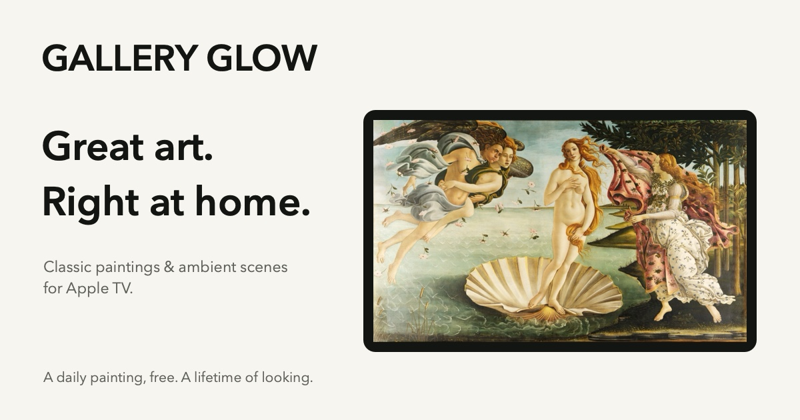
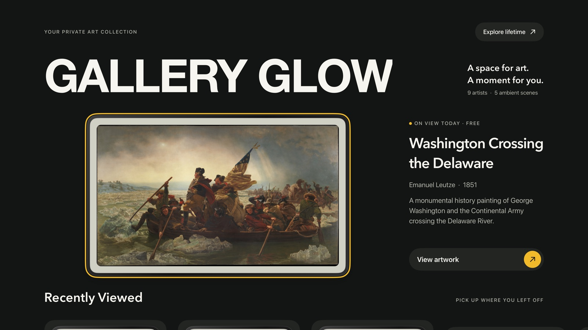

# Gallery Glow

Classic art and ambient scenes for Apple TV. A space for art. A moment for you.

[Website](https://yssf-c.github.io/Gallery-Glow/) · [Support & contact](https://yssf-c.github.io/Gallery-Glow/support.html#contact) · [Privacy](https://yssf-c.github.io/Gallery-Glow/privacy.html)



Browse nine artists, enjoy a different daily painting in full screen for free,
and make the whole collection yours with Gallery Glow Lifetime. One purchase
unlocks every artwork, five animated ambient scenes, and future gallery additions.
No subscription, ads, analytics, or app account.

SwiftUI · tvOS 18+ · Light and dark appearance · Apple TV Top Shelf · StoreKit 2



## Run and test

Open `Gallery Glow.xcodeproj` in a current Xcode with the tvOS platform installed.
Select the **Gallery Glow** scheme and an Apple TV simulator or paired Apple TV.

The Debug scheme uses `Gallery GlowTests/GalleryGlow.storekit` for local purchase
testing. To test App Store Connect products from Xcode, set **Edit Scheme → Run →
Options → StoreKit Configuration → None** and use a Sandbox Apple Account.
TestFlight uses Apple's sandbox automatically; test purchases do not charge you.
The current non-consumable ID is `galleryglow.lifetime.v2`. Verified ownership of
the historical `galleryglow.lifetime` product remains supported.

See [CONTRIBUTING.md](CONTRIBUTING.md) for CI, local validation, and review rules.
All changes go through PRs. `yssf-c` must approve other authors' current changes;
his own PRs need no approval. All PRs still need passing checks.

## Release assets

The current build is **1.0 (7)**. [Listing copy and URLs](app-store-assets/metadata.md)
and [eight 4K promotional screenshots](app-store-assets/release-1.0-7/) match the
current app. Older images outside that directory are historical references.

Capture native screens on the 4K simulator:

```sh
TEST_RUNNER_GALLERY_GLOW_SCREENSHOTS=1 \
TEST_RUNNER_GALLERY_GLOW_SCREENSHOT_DIR=/tmp/gallery-glow-release-7 \
xcodebuild test -project 'Gallery Glow.xcodeproj' -scheme 'Gallery Glow' \
  -destination 'platform=tvOS Simulator,name=Apple TV 4K (3rd generation)' \
  -parallel-testing-enabled NO \
  -only-testing:'Gallery GlowTests/AppStoreScreenshotTests' CODE_SIGNING_ALLOWED=NO
swift Tools/Release/render-assets.swift /tmp/gallery-glow-release-7
```

Choose dark appearance on the simulator to reproduce this set. Native screenshots
show the actual app. Promotional layouts and web previews are generated with
AppKit, using the bundled artwork and screenshot pixels.

Regenerate the layered app icon, App Store icon, in-app mark, Top Shelf banners,
and website icons with `swift Tools/Release/render-brand.swift`. The editable
vector mark also lives in `docs/favicon.svg`. The background layer is opaque;
the landscape and frame remain separate transparent layers for tvOS parallax.

Archive and export with [Tools/Release/ExportOptions.plist](Tools/Release/ExportOptions.plist)
for App Store Connect. Uploading to TestFlight does not submit the app for review.
Confirm the available build number in App Store Connect before the next release.

## Top Shelf and architecture

Regenerate Apple TV shelf cards with `./generate_topshelf_images.sh` after changing
the catalog, palettes, or preview design. It uses the app's catalog, gallery colors,
and palettes to write 888 × 500 JPEGs to `Gallery Shelf/TopShelfImages`. Artwork is
fitted without cropping; tvOS supplies the title below the card. Commit generated
images with their source changes.

[Explore the interactive app anatomy](https://yssf-c.github.io/Gallery-Glow/anatomy.html).
The [diagram source and generation instructions](Tools/Anatomy/README.md) live in
`Tools/Anatomy`.
